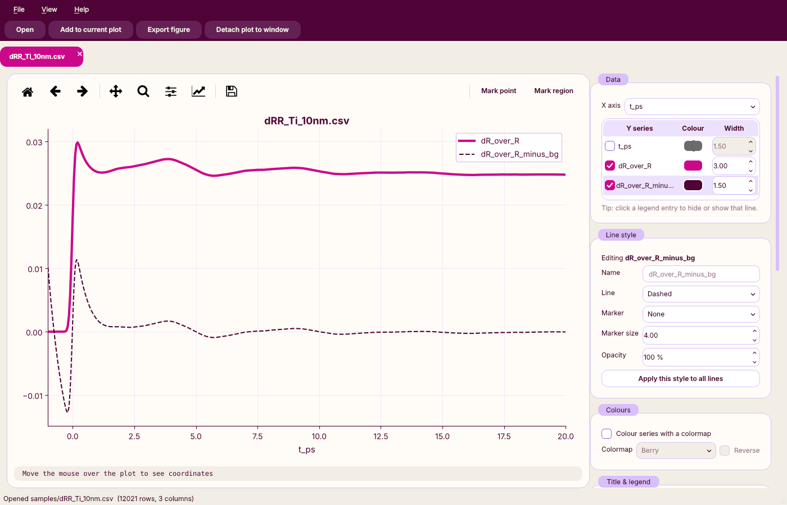
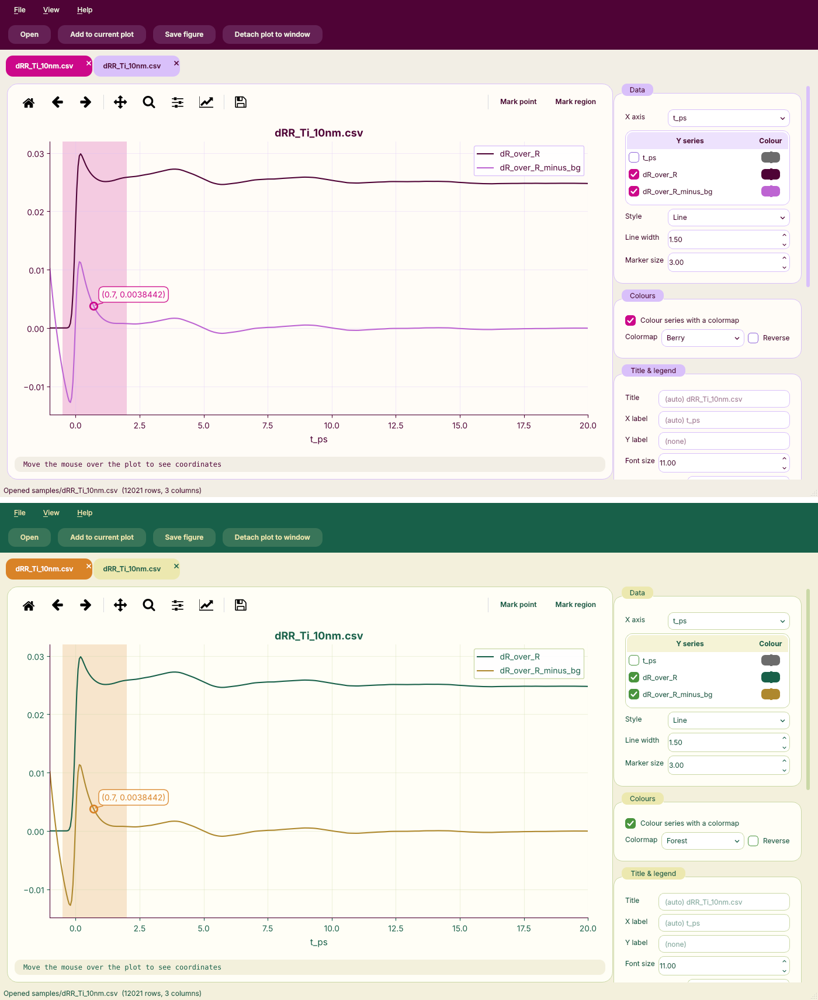

# CSV Plotter


A desktop app for viewing data files as interactive plots. It reads CSV, TSV and
other delimited text files, and you can add more formats later (see below).

## Run

```bash
pip install -r requirements.txt
python -m csvplot                         # then File → Open… (Ctrl+O)
python -m csvplot samples/dRR_Ti_10nm.csv # or pass files on the command line
```

You can also drag files onto the window.



## Features

- **Named sessions**: type a name in the *Session* box on the toolbar (or press F2).
  The name appears in the window title, e.g. "Ti film pump-probe — CSV Plotter".
  Double-click a tab (or press Ctrl+R) to rename that plot. Exported files use the
  plot's name by default.
- **Multiple files**: each file opens in its own tab. Tabs can be closed, reordered,
  or **detached** into separate windows (View → Detach, Ctrl+D). Closing a detached
  window puts the plot back in a tab.
  **File → Add to current plot** (Ctrl+Shift+O) overlays another file on the open plot.
- **Automatic plotting from column names**: the first numeric column is used as X and
  the other columns are plotted against it. You can pick any column for X, or use
  the row number, and tick which columns to show as Y series.
- **Interactive canvas**
  - Mouse wheel zooms around the cursor (hold Shift to zoom only X, Ctrl to zoom only Y)
  - Pan tool: drag to move the plot. Zoom tool: drag a box to zoom into it.
  - Home / Back / Forward step through your view history
  - The cursor's x/y position and the nearest data point are shown under the plot
  - The legend and mark labels can be dragged
- **Marks**: *Mark point* (click to mark a point; it snaps to the nearest data point
  if snapping is on) and *Mark region* (drag to shade an x-range). Right-click a mark,
  or use the Marks list, to remove it. Mark colours are configurable.
- **Per-line styling**: each series has its own colour and line width in the series
  table. Select a row to set its legend name, line style (solid, dashed, dotted,
  dash-dot, none), marker, marker size and opacity. *Apply this style to all lines*
  copies the style to every series.
- **Hide lines**: untick a series, or click its legend entry to hide or show it.
  Hidden lines stay in the legend, faded.
- **Colours**: choose a colour per series, or colour all series from a **colormap**
  (Berry, Forest, viridis, plasma, turbo, coolwarm, tab10, …, can be reversed).
  You can also set the title, axis labels, font size, and legend on/off and position.
  The plot background can be *Grid* or *Plain*.
- **Ticks**: set the major tick step and the number of minor subdivisions (Off, Auto,
  2, 4, 5, 10) for each axis, and the width and length of major and minor ticks. You can also set the tick direction (outside, inside or
  both), put ticks on all four sides for a boxed, journal-style frame, and turn on
  minor gridlines.
- **Axis ranges**: type the min/max values and Apply, or use Auto-fit. The boxes
  update as you pan and zoom. Log scale for X and/or Y.
- **High-quality export** (File → Export figure, Ctrl+S, or the toolbar's save icon):
  PNG, TIFF or JPEG at 150–1200 dpi, or vector SVG, PDF or EPS. Set the output size
  in cm or inches and choose a white, theme-coloured or transparent background.
  The export can use a plain or grid plot area regardless of the on-screen choice,
  and a live **preview** shows the figure exactly as it will be saved. The app
  remembers your last settings. Optional **presets** (journal single, 1.5 or
  double column, 16:9 or 4:3 slide, poster panel) set the size, resolution and font
  size in one click. Exports from the dark theme on a white or transparent
  background automatically use dark text.
- **Accent-coloured axes**: an option under *Title & legend* draws the axes, ticks,
  labels and title in the theme's accent colour.
- **Data table** (optional): the *Data table* toolbar button or View → Show/hide data
  table (Ctrl+T) opens the raw values in a tab next to the plot. It only opens when
  you ask, unless you turn on View → *Open data table with new files*.
- **Themes**: View → Theme switches between *Berry* (periwinkle, magenta, plum, ivory),
  *Forest* (orange, cream, green, deep green) and *Night* (a dark theme for long
  sessions and presentations). The plot toolbar icons follow the theme colour. The app remembers your choice. Each
  theme also adds a colormap with the same name. To add a palette, add a `Theme` to
  `csvplot/theme.py`.



## Icon

The app icon shows two bipolar (derivative-of-Gaussian) echo pulses. The small echo
runs horizontally across the top. The big echo is rotated 90° and drops vertically
from the small echo's midpoint. It is generated by `tools/make_icon.py` into
`csvplot/resources/icon.svg`.

## Adding a file format

Loaders live in `csvplot/loaders.py`. Register a function that returns a
`pandas.DataFrame`:

```python
@register_loader("Excel workbook", ".xlsx")
def load_excel(path):
    return pd.read_excel(path)
```

The Open dialog and drag-and-drop pick it up automatically.

## Tests

```bash
pip install pytest
QT_QPA_PLATFORM=offscreen python -m pytest
```
